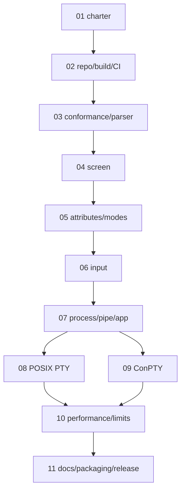

# terminal-window-cmdline — sectioned build guide

Guide only. No implementation code lives in these files; each section is one
unit of work sized for one conversation.

- App distribution: `terminal-window-cmdline-<os>-<arch>`
- Libraries: internal `terminal-vt` and `terminal-pty` modules; no Maven Central
- Release: `1.0.0`; development version `1.0.0-SNAPSHOT`
- Repository: `psiwray-corp/terminal-window-cmdline`

## How to use

1. Read this file only.
2. Read exactly one `docs/guide/NN-*.md`.
3. Reuse the `terminal-window` files listed in that section instead of
   re-deriving them.
4. Implement only that section's deliverables.
5. Update the checklist here and leave all changes uncommitted for the user.
6. A section is done only when every `## Acceptance` box is demonstrated, not
   inferred.

## Context budget

Each section is one conversation. The target is at most 30% of a 1M-token
context, including file reads, generated code, test output, and review. If a
section approaches that ceiling, stop and split at the seam named in its
`## Context budget` block rather than continuing.

Do not read sibling section files. Cross-section constraints are fixed here.
`GUIDE.md` is the only shared state between conversations.

## Fixed facts (do not re-derive)

| Fact | Value | Why |
|---|---|---|
| Group / app distribution | `com.psiwray.organization` / `terminal-window-cmdline-<os>-<arch>` | One standalone app; no Maven Central |
| Libraries | `terminal-vt`, `terminal-pty` | Internal modules; parser/screen are pure |
| Version | `1.0.0`, development `1.0.0-SNAPSHOT` | First release; app CLI compatibility from 1.0.0 |
| Language | Kotlin 2.4.21, JVM target 25 | Same toolchain as `terminal-window` |
| JDK | 25 | Same runtime as `terminal-window` |
| Gradle | 9.9.1 wrapper, Kotlin DSL, version catalog | Same build baseline |
| Window library | `com.psiwray.organization:terminal-window:2.0.0` | Renderer and input source; no core changes in v1 |
| License | MIT | Same license as `terminal-window` |
| Package roots | `com.psiwray.organization.terminal_window_cmdline.vt`, `.pty`, `.app` | Distinct from `terminal_window`; no split package |
| Automatic module names | `com.psiwray.organization.terminal_window_cmdline.vt`, `.pty`, `.app` | Stable names for module path |
| Modules | `:vt`, `:pty`, `:app`, `:benchmarks` | Parser, platform, app, measurements |
| Native access | Pure Java FFM; no JNA, no native helper | One mechanism on all platforms |
| Platforms | Linux, macOS, Windows 10 1809+ | PTY/ConPTY available; no Windows 7/8 |
| Pipe mode | Explicit `--pipe`; `isTty = false` | Never a silent fallback |
| VT scope | T0 + T1a in v1; T1b/T2 tracked; T3 rejected | Barebones but usable |
| C1 controls | 7-bit `ESC` forms only; no 8-bit C1 | UTF-8 ambiguity; matches foot |
| Unicode | UTF-8; East Asian width; no full grapheme clusters in v1 | Explicit v1 boundary |
| Zero-width cap | 9 combining code points per cell | Alacritty's DoS bound |
| Underline styles | Stored `4:0`–`4:5`, not rendered in v1 | Avoid a model reshape later |
| Child environment | `TERM=xterm-256color`, `COLORTERM=truecolor` | Applications recognize the capability set |
| Test corpus | libvterm `.test` files, MIT, attribution required | Proven parser/screen cases |
| Commit policy | The user owns Git history; agents never commit | Same rule as `terminal-window` |

## Non-negotiable invariants

1. `:vt` is pure Kotlin. It must not depend on LWJGL, `terminal-window`, AWT,
   FFM, or platform classes.
2. `:pty` owns every platform process/PTY call. It must not depend on `:vt`
   screen types; it exposes byte streams and lifecycle only.
3. `:app` is the only production module that depends on `terminal-window`;
   `:benchmarks` may depend on it only for projection measurements.
4. No `terminal-window` changes in v1. The projection is lossy and documented:
   no underline/italic/strikethrough rendering, no bar/underline text cursor.
5. Pipe mode is explicit. A missing PTY/ConPTY must fail with a diagnostic, not
   silently fall back to pipes.
6. The parser accepts 7-bit `ESC` forms only. Bytes `0x80`–`0xFF` are UTF-8
   input, not 8-bit C1 controls.
7. Every unbounded external input has a limit: CSI parameters, OSC/DCS string
   length, combining marks per cell, hyperlink URL length when added later.
8. The screen model is owner-thread confined. Reader, writer, and process
   watcher threads publish bytes/exit status, never mutate screen cells.
9. No `System.exit`; no global signal handlers; no global GLFW/AWT hooks.
10. No `!!` in library code. `explicitApi()` is enabled. Public declarations
    have KDoc.
11. Hot paths use indexed loops and primitive arrays. No per-cell objects and
    no per-byte boxing.
12. libvterm test files are copied with their MIT notice and attribution.
13. `TERM`/`COLORTERM` defaults are part of the child environment contract, not
    hidden magic in the parser.
14. The v1 app does not implement scrollback, selection, images, or native
    image packaging. Those are roadmap items, not stubs.

## Kotlin conventions

- Immutable value types are `data class`; stateless helpers are `object`.
- `internal` for implementation. Public API only in `:vt`/`:pty` when needed.
- No coroutines. Threads are explicit and named.
- `use {}` only for `Closeable`; native handles get explicit `close()`.
- Colors are `Int` ARGB at the `terminal-window` boundary; the VT model keeps
  default/indexed/RGB colors separate until projection.
- Tests assert behavior, not source text or wiring.

## Sections

| # | Section | Phase | Depends on | Reuse | Size / split |
|---|---|---|---|---|---|
| 01 | [Charter, decisions, support matrix](docs/guide/01-charter-and-decisions.md) | decisions | — | ADR template, doc structure, `AGENTS.md` | Large docs-only |
| 02 | [Repository, build, quality gates, CI](docs/guide/02-repository-build-and-ci.md) | foundations | 01 | `terminal-window` 02–05, build/CI files | Medium, mostly copy |
| 03 | [Conformance, UTF-8, parser](docs/guide/03-conformance-utf8-and-parser.md) | core | 02 | libvterm tests and parser | Large |
| 04 | [Screen, cursor, scrolling, editing](docs/guide/04-screen-cursor-and-editing.md) | core | 03 | libvterm screen cell, Alacritty flags | Large |
| 05 | [Attributes, modes, queries, alt screen](docs/guide/05-attributes-modes-and-alt-screen.md) | core | 04 | foot/WezTerm SGR, xterm ctlseqs | Large; split SGR vs modes if needed |
| 06 | [Input and encoding](docs/guide/06-input-and-encoding.md) | core | 05 | libvterm keyboard, kitty spec | Large |
| 07 | [ProcessSession, pipe, adapter, CLI](docs/guide/07-process-session-pipe-and-cli.md) | runtime | 06 | `terminal-window` API, examples | Large; split pipe vs adapter if needed |
| 08 | [POSIX PTY](docs/guide/08-posix-pty.md) | platform | 07 | Alacritty/node-pty shape | Medium |
| 09 | [Windows ConPTY](docs/guide/09-windows-conpty.md) | platform | 07 | Alacritty ConPTY, Microsoft docs | Medium |
| 10 | [Performance, limits, fuzzing](docs/guide/10-performance-limits-and-fuzzing.md) | quality | 08, 09 | `terminal-window` performance style | Medium |
| 11 | [Docs, packaging, release](docs/guide/11-docs-packaging-and-release.md) | delivery | 10 | `terminal-window` 21–24, release files | Medium, mostly copy |

## Dependency graph

## Reuse from `terminal-window`

Copy, then change only project-specific facts. Do not re-plan or re-derive.

| Source | Use |
|---|---|
| `docs/adr/0000-template.md` | Every ADR in section 01 |
| `docs/architecture.md` | Structure for our architecture document |
| `docs/compatibility.md` | Structure for our compatibility policy |
| `AGENTS.md` | Agent rules, adapted to this project |
| `docs/guide/02-repository-bootstrap.md` | Section 02 bootstrap |
| `docs/guide/03-dependencies-and-natives.md` | Section 02 dependencies |
| `docs/guide/04-quality-gates.md` | Section 02 quality gates |
| `docs/guide/05-ci-pipeline.md` | Section 02 CI |
| `.editorconfig`, `.gitattributes`, `.gitignore` | Section 02 |
| `gradlew`, `gradle/wrapper/`, `gradle/libs.versions.toml` | Section 02 |
| `ci/*.sh`, `.github/workflows/`, `.forgejo/workflows/` | Section 02 |
| `library/build.gradle.kts` Spotless/Dokka blocks | Section 02 |
| `docs/guide/21-documentation.md` | Section 11 |
| `docs/guide/24-release-runbook.md` | Section 11 |
| `docs/release/*`, `scripts/release*.sh` | Section 11 |
| `CONTRIBUTING.md`, `CHANGELOG.md`, `README.md` structure | Section 11 |

Project-specific deltas:

- Artifact IDs, package roots, module names, and version differ.
- Remove v1 notice and v1 compatibility material.
- CI adds macOS and Windows PTY jobs; Linux keeps Xvfb for GL tests.
- Add `--enable-native-access=ALL-UNNAMED`; keep macOS `-XstartOnFirstThread`.
- The app ships as a platform distribution. Do not add Maven Central
  publishing or release-signing machinery.
- No `terminal-window` core changes.

## v1 cut line

- **T0:** mandatory.
- **T1a:** mandatory for the v1 executable: alternate screen, DECSCUSR,
  bracketed paste, focus, mouse 1000/1002/1003 + SGR 1006, 256/truecolor,
  OSC 0/1/2, DECRQM, synchronized output 2026, kitty, modifyOtherKeys, DECRQSS
  for SGR/DECSTBM/DECSCUSR.
- **T1b:** tracked in `docs/roadmap.md`; not v1.
- **T2:** tracked in `docs/roadmap.md`; not v1.
- **T3:** rejected.

## Progress

- [x] 01 Charter, decisions, support matrix
- [x] 02 Repository, build, quality gates, CI
- [x] 03 Conformance, UTF-8, parser
- [x] 04 Screen, cursor, scrolling, editing
- [x] 05 Attributes, modes, queries, alt screen
- [x] 06 Input and encoding
- [x] 07 ProcessSession, pipe, adapter, CLI
- [x] 08 POSIX PTY
- [x] 09 Windows ConPTY
- [x] 10 Performance, limits, fuzzing
- [x] 11 Docs, packaging, release

## Related

[Architecture](docs/architecture.md) · [Compatibility](docs/compatibility.md) ·
[VT support](docs/vt-support.md) · [Roadmap](docs/roadmap.md)
