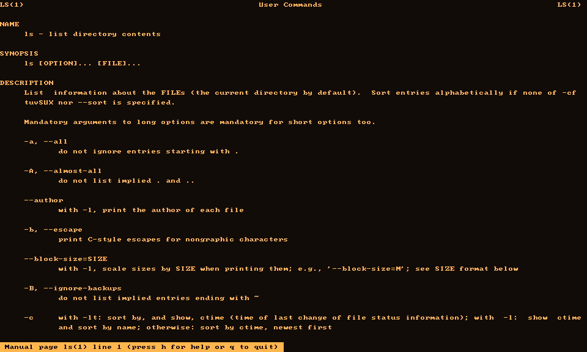
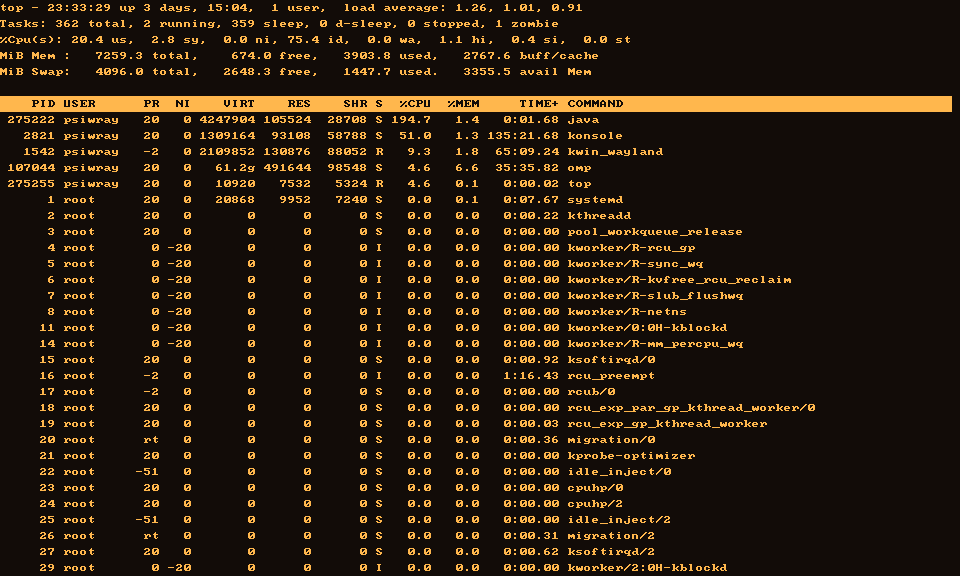

# terminal-window-cmdline

A barebones VT100/xterm process input/output processor and terminal emulator
built on [`terminal-window`](https://github.com/psiwray-corp/terminal-window).

**Status:** 1.0.0. The T0 + T1a scope is implemented for a shell or editor.
There is no Maven Central publication; the product is the per-platform
application distribution.

## Shape

| Module | Role |
|---|---|
| `:vt` | UTF-8, DEC/ANSI parser, screen model, input encoder |
| `:pty` | POSIX PTY and Windows ConPTY backends, pipe mode |
| `:app` | `terminal-window` adapter, CLI, frame loop |

The libraries are internal modules. The release artifact is the `:app`
distribution with the host LWJGL natives and launcher.

## Screenshots

`man ls` in a PTY:



`top` in a PTY:



## Requirements

- JDK 25.
- Linux with X11, macOS, or Windows 10 1809+.
- A desktop OpenGL 3.3 context for the window.

## Download

CI runs tests on every push and pull request. A release-tag (`v*`) run builds
one distribution per build host, creates the forge release, and attaches:

```text
terminal-window-cmdline-<os>-<arch>-<version>.zip
terminal-window-cmdline-<os>-<arch>-<version>.tar
SHA256SUMS
```

Download the archive for your platform from the repository release page,
unpack it, and keep the JDK 25 `java` executable on `PATH`.

## Run

A PTY shell:

```bash
terminal-window-cmdline-linux-x64-1.0.0-SNAPSHOT/bin/terminal-window-cmdline -- /bin/bash
```

A full-screen program directly:

```bash
terminal-window-cmdline-linux-x64-1.0.0-SNAPSHOT/bin/terminal-window-cmdline -- vim -u NONE -n
```

Windows uses `terminal-window-cmdline.bat` in the same directory:

```text
terminal-window-cmdline.bat -- cmd.exe
```

The launcher supplies `-Djava.awt.headless=true`,
`--enable-native-access=ALL-UNNAMED`, and `-XstartOnFirstThread` on macOS.

## Pipe mode

PTY/ConPTY is the default. Use `--pipe` only for non-interactive commands:

```bash
terminal-window-cmdline-linux-x64-1.0.0-SNAPSHOT/bin/terminal-window-cmdline --pipe -- sh -c 'printf "hello\n"'
```

Pipe mode has `isTty = false`, no resize, and no job control. Interactive
programs must use the default PTY/ConPTY mode. A missing platform backend is an
error; it never silently falls back to pipes.

## Build

```bash
./gradlew build
./gradlew spotlessApply check
```

`bash ci/build.sh` runs the documentation link check, JDK check, formatting,
build, and Dokka. Platform integration tests live behind
`bash ci/integration-test.sh`; Linux runs them under Xvfb.

The pipe-mode quickstart used by CI is:

```bash
./gradlew :app:run --args="--pipe -- /bin/echo hello"
```

See [`docs/release/runbook.md`](docs/release/runbook.md) for distribution
verification and release steps.

Build and inspect the local distribution with:

```bash
./gradlew :app:installDist
```

The installed launcher is under
`app/build/install/terminal-window-cmdline-<platform>/bin/`.

## Scope

v1 implements the T0 core plus the T1a subset needed by a shell or editor:
alternate screen, cursor shapes, bracketed paste, focus, mouse modes, 256/
truecolor, titles, DECRQM, synchronized output, kitty keyboard, and
`modifyOtherKeys`. The normative matrix is
[`docs/vt-support.md`](docs/vt-support.md).

Not implemented in v1:

- scrollback, selection, or clipboard UI;
- images or sixel;
- underline/italic/strikethrough rendering;
- native-image or `jpackage` installers.

Deferred work is tracked in [`docs/roadmap.md`](docs/roadmap.md).

## License

MIT. See [`LICENSE`](LICENSE).
