# Architecture

This document is the structural contract for `terminal-window-cmdline` 0.1.
It fixes module boundaries, ownership, and the byte-to-screen pipeline. The
normative VT behavior is in [`vt-support.md`](vt-support.md); decisions are in
[`adr/`](adr/).

## Module map

| Module | Package | Responsibility | Must not depend on |
|---|---|---|---|
| `:vt` | `com.psiwray.organization.terminal_window_cmdline.vt` | UTF-8, parser, screen, modes, input encoder, responses | LWJGL, `terminal-window`, AWT, FFM, platform |
| `:pty` | `...terminal_window_cmdline.pty` | `ProcessSession`, pipe, POSIX PTY, ConPTY, lifecycle | `:vt` screen/parser types |
| `:app` | `...terminal_window_cmdline.app` | `terminal-window` adapter, projection, CLI, frame loop | Platform-native calls directly |
| `:benchmarks` | `...terminal_window_cmdline.benchmarks` | Parser/screen measurements | — |

Rules:

1. `:vt` is pure Kotlin. It is the only module with parser and screen logic.
2. `:pty` exposes bytes and lifecycle only. It never imports `:vt`.
3. `:app` is the only production module that imports `terminal-window`/LWJGL;
   `:benchmarks` may import `terminal-window` only to measure projection.
4. No module cycles.
5. `internal` is the default in `:app`; public API is minimized.

## Object map

| Type | Module | Responsibility |
|---|---|---|
| `Parser` | `:vt` | Williams state machine; emits parser events |
| `ParserEvent` | `:vt` | `Print`, `Execute`, `Csi`, `Esc`, `Osc`, `Dcs`, `Apc`, `Pm`, `Sos` |
| `Utf8Decoder` | `:vt` | Incremental UTF-8; invalid bytes become U+FFFD |
| `TerminalState` | `:vt` | Modes, pen, cursor, margins, tab stops, responses |
| `Screen` | `:vt` | Cell grid, lines, width/wrap flags, damage |
| `CellBuffer` | `:vt` | Struct-of-arrays storage + rare-data side table |
| `CellFlags` | `:vt` | Wide/spacer/wrap flags |
| `WidthTable` | `:vt` | UAX #11 width classification |
| `ScreenDamage` | `:vt` | Bounded damage rectangles |
| `Attributes` | `:vt` | Attribute bitmask and underline style |
| `Color` | `:vt` | Default, indexed, or RGB |
| `Palette` | `:vt` | 256-color table and defaults |
| `Modes` | `:vt` | ANSI/DEC modes, mouse, focus, paste, keyboard |
| `AlternateScreen` | `:vt` | Primary/alternate buffers with per-screen state |
| `Responder` | `:vt` | Bounded terminal-query response queue |
| `Sgr` | `:vt` | SGR parsing and DECRQSS serialization |
| `DecRqm` | `:vt` | Mode-query responses |
| `DecRqss` | `:vt` | Status-string responses |
| `Key` / `Modifiers` / `MouseButton` / `Action` | `:vt` | Neutral input tokens |
| `InputEvent` | `:vt` | Key, char, mouse, scroll, focus, paste events |
| `InputEncoder` | `:vt` | Key/mouse/focus/paste to bytes |
| `LegacyKeymap` | `:vt` | Table-driven VT100/xterm key sequences |
| `KittyKeyboard` | `:vt` | Per-screen kitty flags, stack, and encoder |
| `ModifyOtherKeys` | `:vt` | xterm levels 1–2 encoder |
| `ScreenView` | `:vt` | Read-only visible-screen snapshot for projection |
| `ProcessSession` | `:pty` | Byte I/O, resize, interrupt, terminate, exit |
| `PipeSession` | `:pty` | `ProcessBuilder` backend, `isTty = false` |
| `PosixPtySession` | `:pty` | Linux/macOS FFM backend |
| `ConPtySession` | `:pty` | Windows FFM backend |
| `ByteRing` | `:pty` | Bounded reader-to-owner buffer |
| `TerminalWindowAdapter` | `:app` | Drain, parse, project, frame, input |
| `ScreenProjection` | `:app` | `ScreenView` → `TerminalMatrix` |
| `CommandLine` | `:app` | CLI parsing and child environment |
| `AppLoop` | `:app` | Owner-thread loop and shutdown |

## Data flow

```mermaid
flowchart LR
  CHILD[child process] <-->|master / console| PTY[PTY or ConPTY]
  PTY --> READER[reader thread]
  READER --> RING[(bounded byte ring)]
  RING -->|owner drains| PARSER[Parser]
  PARSER --> STATE[TerminalState]
  STATE --> SCREEN[Screen]
  SCREEN --> VIEW[ScreenView]
  VIEW --> PROJ[ScreenProjection]
  PROJ --> MATRIX[TerminalMatrix]
  MATRIX --> WINDOW[TerminalWindow]
  WINDOW -->|KeyEvent / CharEvent / Mouse| ENC[InputEncoder]
  ENC --> WQUEUE[(writer queue)]
  WQUEUE --> WRITER[writer thread]
  WRITER --> PTY
  STATE -->|query replies| WQUEUE
```



Pipe mode replaces `PTY` with `ProcessBuilder` streams and sets
`isTty = false`. The parser, screen, projection, and input encoder are
unchanged.

## Parse and frame pipeline

1. **Read.** The PTY reader blocks in `read` and appends to a bounded ring. If
   the ring is full, the reader blocks; output is not dropped.
2. **Drain input.** The owner drains window input first and encodes it to the
   writer queue, so a flood cannot starve keystrokes.
3. **Parse.** The owner parses at most a fixed byte/time budget from the ring.
   Parser events mutate `TerminalState` and `Screen`.
4. **Respond.** Query replies produced by `TerminalState` are queued to the
   writer.
5. **Project.** `ScreenProjection` writes the visible screen into
   `TerminalMatrix`: reverse, bold brightening, invisible, wide/continuation,
   block cursor via reverse.
6. **Frame.** `TerminalWindow.frame()` uploads/draws at most once if the matrix
   is dirty or a repaint was requested.
7. **Resize.** The owner computes the cell grid from the matrix/framebuffer,
   resizes `Screen`, then calls `ProcessSession.resize`. POSIX uses
   `TIOCSWINSZ`; Windows uses `ResizePseudoConsole`. Pipe mode returns false.
8. **Exit.** The watcher publishes `ProcessExit`; the owner drains remaining
   output, then closes the window or shows the exit status.

No parser thread. The screen model is owner-thread confined.

## Thread map

| Thread | Calls | Never calls |
|---|---|---|
| Service thread | GLFW init/poll/window state through `terminal-window` | Parser, screen, projection |
| Owner thread | Drain ring, parse, mutate screen, project, `window.frame()`, encode input | Direct PTY `read`/`write` |
| PTY reader | Blocking `read` into the ring | Screen/parser |
| PTY writer | Blocking `write` from the queue | Screen/parser |
| Process watcher | `waitpid` / `WaitForSingleObject` | Screen/parser |

`terminal-window`'s owner-thread rules apply unchanged: matrix writes and
`frame()` happen on the window owner thread.

## Process model

One `ProcessSession` interface, three backends:

```text
PipeSession        ProcessBuilder, isTty=false
PosixPtySession    posix_openpt/posix_spawn(SETSID), Linux/macOS
ConPtySession      CreatePseudoConsole/CreateProcessW, Windows 10 1809+
```

The child gets the slave/console as fd 0/1/2, so `isatty()` is true on PTY and
ConPTY. Pipe mode is explicit and never a fallback.

POSIX uses `posix_spawn`, not `fork`, so no JVM code runs in a forked child.
Windows uses a hand-written `STARTUPINFOEXW` layout, validated in CI. ConPTY
publishes the child exit only after `ClosePseudoConsole` returns, so the reader
has been allowed to drain final output. A forced close closes the host read end
before the console handle so a stopped reader cannot deadlock shutdown. macOS
requires a controlling-terminal spike; see ADR-0009.

## Projection contract

`TerminalMatrix` has one code point, fg, and bg per cell. The adapter maps:

- reverse → swap fg/bg;
- bold → brighten indexed 0–7;
- dim → blend toward bg or leave;
- invisible → background only;
- wide → primary + blank continuation;
- combining → base only;
- underline/italic/strikethrough/hyperlink → dropped;
- cursor → reverse the cell (block);
- selection → reverse cells.

No `terminal-window` changes in v1. The loss is documented, not hidden.

## Error model

- Library code throws on misuse and unrecoverable environment failures.
- Parser never throws on arbitrary bytes; it ignores malformed sequences.
- Limits: CSI parameters, OSC/DCS length, combining marks. Exceeding them
  enters ignore state or drops marks; no unbounded allocation.
- PTY errors carry the syscall, errno/Win32 code, and platform.
- Windows without ConPTY fails with a clear minimum-version diagnostic.
- macOS controlling-terminal failure is reported at startup, not deferred to
  the first job-control operation.
- No `System.exit`, no global signal handlers, no global GLFW/AWT hooks.

## Decision index

| Concern | ADR |
|---|---|
| Identity, modules, packages | ADR-0001, ADR-0004 |
| License | ADR-0002 |
| Runtime, toolchain, FFM | ADR-0003 |
| VT scope | ADR-0005 |
| Parser | ADR-0006 |
| Screen/Unicode | ADR-0007 |
| Input | ADR-0008 |
| Process/PTY | ADR-0009 |
| Threading | ADR-0010 |
| Projection | ADR-0011 |
| Packaging | ADR-0012 |

## Related

[VT support](vt-support.md) · [Compatibility](compatibility.md) ·
[Roadmap](roadmap.md) · [GUIDE](../GUIDE.md)
